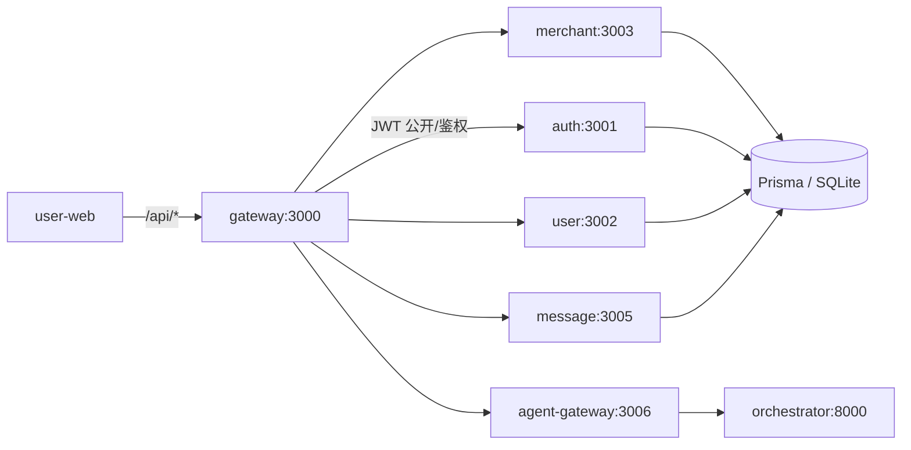

# 宠伴 PetPal Monorepo

宠物综合服务平台（对齐完整计划 V3）。当前已落地 **MVP（M1～M3）+ 扩展频道**：

- 真实短信登录（开发验证码）、商户找店、预约 → 核销 → 评价
- 商城（商品 / 购物车 / 订单 / 商品评价）
- **医疗板块**：线上问诊（¥5 服务费起）+ 线下就医（附近医院）
- **上门和寄养服务**：到店寄养 + 上门遛狗/喂食/换猫砂等
- **领养 / 宠物售卖**：机构领养（无偿/有偿）+ 入驻店/繁育场售宠（高监管、无活体一键下单）
- **毛孩子圈子**：类小红书双列 Feed，图文/短视频/经验帖，点赞评论（底栏「圈子」）
- **Python Agent**：多轮对话记忆、同步宠物档案 / 预约 / 订单、只读查店工具（默认 DeepSeek，失败规则降级）

更细的架构说明见 [docs/ARCHITECTURE.md](docs/ARCHITECTURE.md)。

---

## 系统结构图

```text
┌──────────────────────────────────────────────────────────────────────┐
│  客户端                                                               │
│  user-web:5175 · merchant-web:5180 · admin-web:5181 · Flutter/小程序   │
└─────────────────────────────┬────────────────────────────────────────┘
                              │  /api → Vite 代理 / HTTP
                              ▼
┌──────────────────────────────────────────────────────────────────────┐
│  gateway :3000                                                        │
│  CORS · 安全头 · 限流 · JWT 鉴权 · 路径代理 · /health/deps            │
└─┬──────┬──────┬──────┬──────┬──────┬─────────────────────────────────┘
  │      │      │      │      │      │
  ▼      ▼      ▼      ▼      ▼      ▼
auth   user* merchant inspect message  agent-gateway
:3001  :3002  :3003   :3004   :3005    :3006
       *含宠物档案 + 毛孩子圈子 API
                              │
                              ▼
                     orchestrator :8000
                     (FastAPI + DeepSeek)
                              │
                              ▼
                     packages/db (Prisma)
                     本地默认 SQLite
```

### 请求主路径



### AI 聊天链路（易踩坑）

```text
user → POST /agent/chat  (+ Bearer 可选，登录后同步档案)
  → gateway:3000
      · 公开路径也可注入 JWT → x-user-id
  → agent-gateway:3006
      · 记忆落库 message:3005（AgentSession / AgentMessage）
      · 注入 pets / bookings / orders；工具 search_merchants 等
  → orchestrator:8000/v1/chat（Python，多轮 history + context）
  → DeepSeek（失败则 fallback 文案）
```

**只起 gateway + orchestrator 不够，缺 3006 / 3005 会 502 或无法记记忆。** 推荐：`pnpm services:start` + `pnpm agent:ensure`。

| 能力 | 说明 |
|---|---|
| 对话记忆 | 游客 `petpal_ai_guest` + 会话 `petpal_ai_session`；登录后 `POST /agent/memory/merge` |
| 档案同步 | 登录态聊天会带宠物档案；可问「我的猫叫什么」 |
| 历史恢复 | `GET /agent/memory`；user-web AI Tab 常驻，切 Tab 不丢气泡 |
| 只读工具 | 查严选店 / 宠物 / 预约 / 商城订单（Agent 不直连 DB、不写单） |

---

## 仓库结构

```text
apps/
  user-web/         用户端 H5（主预览端）:5175
  merchant-web/     商家端 H5 :5180
  admin-web/        运营/评审后台 :5181
  user-app/         Flutter 用户 App
  inspect-mini/     微信小程序考察端
packages/
  design-tokens/    共享色板 / 间距 / 圆角
  db/               Prisma Schema / Client / Seed
  shared/           共享类型与错误码
  config/           TS 基础配置
services/
  gateway/          API 网关 :3000
  auth/             认证 :3001
  user/             用户 / 宠物档案 / 毛孩子圈子 :3002
  merchant/         商户 / 预约 / 商城 / 服务目录 / 领养售宠 :3003
  inspect/          考察 / 评审 / 信用分 :3004
  message/          消息中心 / 人商会话 / AI 记忆 API :3005
  agent-gateway/    Agent 接入 · 记忆编排 · 工具代理 :3006
agents/
  orchestrator/     Python FastAPI · 意图 · 记忆感知 LLM · 工具请求 :8000
scripts/
  start-core-services.mjs   编译并启动核心 Nest
  ensure-agent-stack.mjs    确保 AI 链路
  smoke-check.mjs           冒烟验收
docker/
  docker-compose.yml
```

---

## 业务频道速查

### 预约 `channel` / 服务 `kind`

| 值 | 含义 | 完成方式 |
|---|---|---|
| `onsite` | 到店（洗护/寄养到店等） | 商家扫码核销 |
| `online_consult` | 线上问诊 | 用户 `POST /bookings/:id/complete` |
| `home_visit` | 上门服务 | 用户确认完成（需 `address`） |

### 领养 / 宠物售卖 `PetListing.channel`

| 值 | 含义 | 规则 |
|---|---|---|
| `adopt` | 领养 | 可无偿（¥0）或有偿；申请 + 站内会话 |
| `sale` | 宠物售卖 | 入驻店/繁育场；证照检疫必填；意向沟通，无活体一键购 |

API：`GET /pet-listings?channel=adopt|sale`、`GET /pet-listings/:id`、`POST .../apply`、`POST .../contact`。

### 用户端入口（`apps/user-web`）

底栏：**首页 | 找店 | AI | 圈子 | 我的**

| 入口 | overlay / 页面 |
|---|---|
| 医疗 | `MedicalHubPage` |
| 上门/寄养 | `CareHubPage` |
| 领养/宠物售卖 | `AdoptHubPage` |
| 商品 | `MallPage` |
| AI 助手 | Tab=`AIChatPage`（常驻 `v-show`，记忆 + 档案同步） |
| 毛孩子圈子 | Tab=`CircleFeedPage`；详情/发帖为 overlay |
| 消息中心 | overlay=`messages`（首页右上角未读角标 / 「我的」入口，不再占底栏） |
| 我的 | Tab=`ProfilePage`（首页「去添加」档案入口） |

路由由 `App.vue` 的 `tab` + `overlay` 状态机控制（非 vue-router）。

圈子 API（`user` 服务，经 gateway）：`GET/POST /users/community/posts`、点赞/评论；列表公开读，写操作需登录。

---

## 快速启动（推荐流程）

### 0. 依赖

- Node.js >= 20、pnpm 9（`corepack enable`）
- Python 3.11+（Agent / DeepSeek）
- Docker Desktop（可选：Postgres/Redis/MinIO）

### 1. 环境与数据库

```bash
cp .env.example .env
# 填写 DEEPSEEK_API_KEY、JWT_SECRET
# 地图（可选）：AMAP_WEB_KEY、VITE_AMAP_JS_KEY、VITE_AMAP_SECURITY_CODE
# Windows 建议绝对路径：
# DATABASE_URL=file:D:/petserver/packages/db/prisma/dev.db

pnpm install
pnpm --filter @petpal/shared build
pnpm db:generate
pnpm db:migrate
pnpm db:seed
# seed 已串联：主种子 + 扩展服务 + 商城商品 + 领养/售宠 + 圈子示例帖
# 含迁移：Agent 记忆表、community_posts / likes / comments 等
```

### 2. 启动后端（一键）

```bash
# 编译并用 tsc 产出 dist，再拉起 auth/user/merchant/inspect/message/gateway/agent-gateway
# 注意：Windows 上 Nest 偶发空 dist，核心服务已改为 tsc（含 message / agent-gateway）
pnpm services:start

# 另开终端：确保 orchestrator(:8000) + agent-gateway(:3006) 健康
pnpm agent:ensure
```

仅编译不启动：`pnpm services:build`。  
单独稳住 message：`pnpm --filter @petpal/message run start:stable`。

验证：

```bash
curl http://localhost:3000/health
curl http://localhost:3000/health/deps
curl http://localhost:3000/merchants
curl "http://localhost:3000/pet-listings?channel=adopt"
curl "http://localhost:3000/users/community/posts"
pnpm smoke
```

演示账号：用户 `13800000001` / 店长 `13900000001`，验证码 `123456`。

### 3. 启动前端

```bash
pnpm --filter @petpal/user-web dev      # http://localhost:5175
pnpm --filter @petpal/merchant-web dev  # :5180
pnpm --filter @petpal/admin-web dev     # :5181
```

user-web 通过 Vite 把 `/api` 代理到 `gateway:3000`。

---

## 安全与稳定性（已落地要点）

| 项 | 说明 |
|---|---|
| 剥离伪造头 | 网关丢弃客户端伪造的 `x-user-id` / `x-user-role`，仅由 JWT 注入 |
| 公开路径可选登录 | `/agent/chat`、`GET /agent/*`、`GET /users/community/*` 等：无 Token 可访问；有合法 Bearer 仍注入身份 |
| CORS | 开发限制本地前端端口；生产配置 `GATEWAY_CORS_ORIGIN` |
| 限流 | 全站 / 认证路径滑动窗口；短信同号限流 `AUTH_SMS_RATE_LIMIT` |
| 安全响应头 | `X-Content-Type-Options`、`X-Frame-Options`、`Referrer-Policy` 等 |
| 请求追踪 | 自动 `X-Request-Id` |
| 代理超时 | `GATEWAY_PROXY_TIMEOUT_MS` / `GATEWAY_AGENT_TIMEOUT_MS` |
| AI 限流 | `AGENT_CHAT_RATE_LIMIT`（agent-gateway） |
| 生产错误 | `NODE_ENV=production` 时网关 502 不回传内部 error 细节 |

生产上线前务必：**更换 `JWT_SECRET`**、配置 CORS、关闭或替换 `DEV_SMS_CODE`。

---

## 冒烟验收

```bash
pnpm smoke
```

覆盖：健康检查、商户列表、领养/售宠列表、服务目录、登录鉴权、预约核销评价、AI 聊天。

建议手测：

- AI：登录 → 问「我的猫叫什么」→ 切 Tab 再回助手 → `GET /agent/memory`
- 圈子：底栏「圈子」刷 Feed → 详情点赞/评论 → 发帖；首页右上角进消息中心看未读

---

## 地图 / LBS（高德）

| 场景 | 入口 |
|------|------|
| 服务定位 | 首页城市条 / 地图「换定位」 |
| 找店地图 | 首页「查看地图」 |
| 导航到店 | 门店详情 |
| 商城配送 | 商城订单轨迹 |
| 上门位置 | 服务订单实时位置 |

环境变量：

| 变量 | 用途 |
|---|---|
| `AMAP_WEB_KEY` | 后端逆地理 / 搜索（仅服务端） |
| `VITE_AMAP_JS_KEY` | 前端 JS 地图 |
| `VITE_AMAP_SECURITY_CODE` | JS API 2.0 安全密钥（控制台开启后必填，否则回退演示图层） |
| `LOCATION_TRACK_MOCK` | 无真实骑手时模拟轨迹 |

浏览器 GPS 会做 **WGS84 → GCJ-02** 转换后再用于高德。

---

## 文档

- [架构说明](docs/ARCHITECTURE.md)
- [Agent 编排（Python）](agents/orchestrator/README.md)
- [用户 H5](apps/user-web/README.md)
- [用户服务（含圈子）](services/user/README.md)
- [数据库包](packages/db/README.md)
- [缺失项实施指导](docs/缺失项实施指导/宠伴PetPal_项目缺失项详细实施指导.md)（部分章节偏旧，以本 README / ARCHITECTURE 为准）

## 本期仍未做（后续）

真实支付/退款、真实运力定位、OCR/天眼查、蓝牙信标、Temporal、处方药合规问诊、完整八大 Agent / LangGraph 生产级实现、向量长期记忆。
